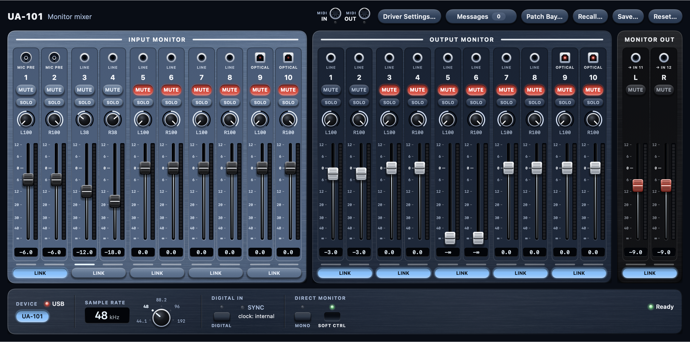
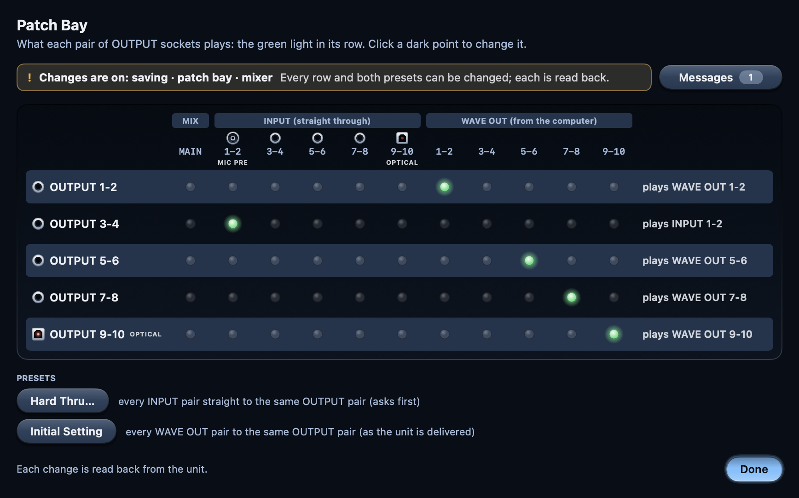
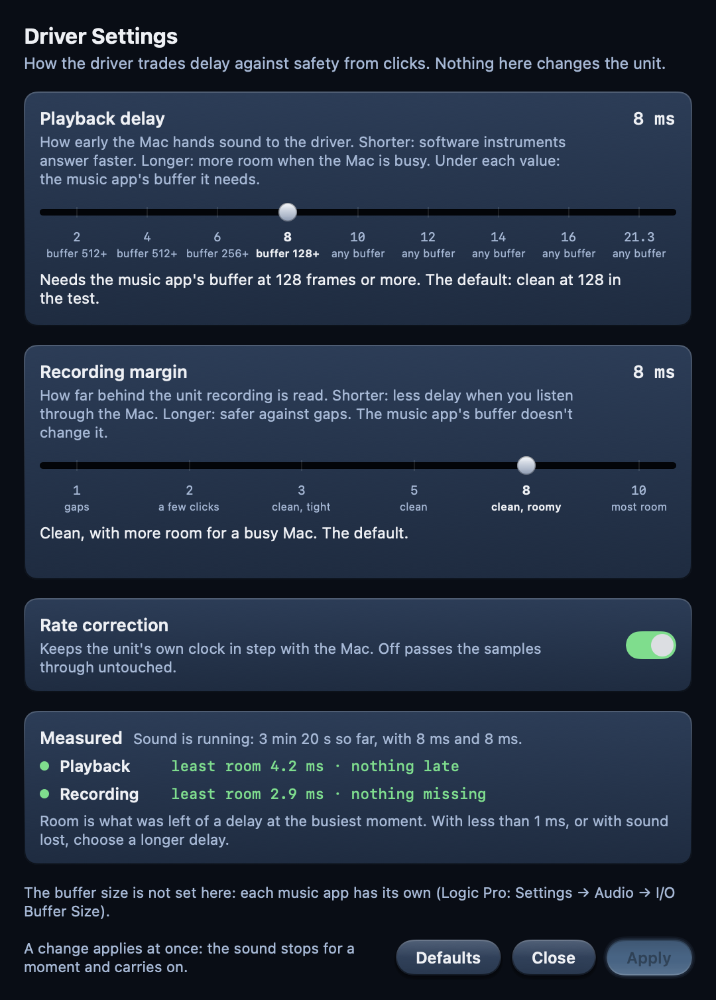

# UA-101 Driver for Apple silicon Macs

A driver and control app for the **Edirol / Roland UA-101** USB audio interface on Macs with Apple silicon (M1 and later). Roland's own driver stopped working years ago; with this one the UA-101 works again as an ordinary sound and MIDI device on a current Mac.



**[Download the latest version](../../releases/latest)**: `UA-101 Driver.pkg` and the manual as a PDF.

## What you get

- **Sound in every app.** The UA-101 shows in System Settings → Sound, Logic Pro and every other music app: up to 12 inputs (the monitor mix included) and 10 outputs, at 44.1, 48, 88.2, 96 and 192 kHz (6 each way at 192 kHz). The channels carry the names of the sockets (INPUT 1-8, OPTICAL IN, MONITOR OUT; OUTPUT 1-8, OPTICAL OUT).
- **MIDI.** A keyboard on the box's MIDI IN and MIDI OUT shows in every MIDI app as **UA-101 MIDI**, and in Audio MIDI Setup with the box's picture.
- **UA-101 Control**, the control panel:
  - the direct monitor mixer: mute, solo, pan, volume and stereo link for every channel, with meters;
  - the patch bay: what each pair of OUTPUT sockets plays;
  - the box's five memories: recall, save, reset to factory;
  - backups of the settings as files on your Mac, made by themselves before every bigger change;
  - Driver Settings: how much delay the driver uses, with what was measured while sound ran.
- **Every account on the Mac** gets the sound, the MIDI and the control panel.
- **A full manual** in the app's Help menu, and as a PDF.
- **Nothing goes over the internet.**

| Patch bay | Driver Settings |
|---|---|
|  |  |

## What you need

- A Mac with Apple silicon (M1 or later).
- macOS 14 Sonoma or later. *Tested on macOS 27.2 on an M1 MacBook Pro; the versions in between are built for but not yet tried.*
- An Edirol UA-101 with its rear **Hi-Speed** USB switch on, connected to the Mac (directly or through a hub).

## Install

1. Download **UA-101 Driver.pkg** from the [latest release](../../releases/latest).
2. Quit the apps that play sound. Double-click the file.
3. The installer isn't signed through Apple's paid developer program, so macOS says it **can't check it** and won't open it. Click **Done**. Then open **System Settings → Privacy & Security**, scroll down to **Security**, click **Open Anyway** next to the installer's name, type your password and click **Open Anyway** again. You do this once for each downloaded copy.
4. Follow the installer's pages, click **Install** and type your password.
5. Open **UA-101 Control** from Applications. With the box on, it says **Ready**.

**Check your download (optional):** each release page shows the installer's SHA-256 checksum, and has it in the file `UA-101 Driver.pkg.sha256`. In Terminal, type `shasum -a 256 ~/Downloads/"UA-101 Driver.pkg"` and press Return. The long number it prints must be the same as the one on the release page. If it isn't, don't open the file: download it again from the release page.

To use the UA-101 for the whole Mac, choose it in **System Settings → Sound**. In Logic Pro: **Settings → Audio → Devices**.

**Update:** install a newer `UA-101 Driver.pkg` the same way, over the old one. Your Driver Settings, your backups and the box's own settings stay.

## Remove

Quit the apps that use the UA-101. In UA-101 Control choose **UA-101 Control → Uninstall UA-101…** and pick one:

- **Remove the Driver, Keep My Settings**: the driver, its MIDI device and the app go. Your Driver Settings and the app's choices stay, for a later install.
- **Remove Everything**: every UA-101 file and setting on the Mac goes too, in every account. A tick (on to start with) keeps your backup files and reports.

macOS asks for an administrator's password. The box's own settings and memories are never touched. With the tick off, your UA-101 Backups and UA-101 Reports folders go to the Trash, never deleted for good. If macOS's privacy protection refuses the uninstaller something (the Documents folder, Help Viewer's copy of the help), that stays, and the last window lists it as "kept (macOS refused)" so you can remove it in the Finder.

If the app is already gone, type this in Terminal (Applications → Utilities), with the quotes, and press Return. It asks the same two choices:

```
"/Library/Application Support/ua101-driver/uninstall.sh"
```

## Good to know

- The sample rate is set with the **SAMPLE RATE** knob on the box, with the box switched off, as Roland asks.
- The box's **Full-Speed** mode (the USB switch down) is not supported.
- UA-101 Control doesn't need to be open for sound or MIDI.

## For developers

The whole source is here. Build and test it with Apple's command line tools only:

```bash
make test
```

| Folder | What it is |
|---|---|
| `src/` | USB streaming, the helper `ua101d`, the Core Audio plug-in (`plugin/`), the CoreMIDI plug-in (`midiplugin/`), test programs |
| `app/` | UA-101 Control (Swift) |
| `manual/` | The manual's pages and pictures |
| `install/` | Installer package, install and uninstall scripts |
| `tests/` | Offline tests and recorded test data |
| `docs/` | [Architecture](docs/architecture.md), [building](docs/building.md), [control protocol](docs/control-protocol.md), [hardware](docs/hardware.md), [test programs](docs/test-programs.md) |

See [CONTRIBUTING.md](CONTRIBUTING.md). Reports from other Macs and macOS versions help most.

## Licence and thanks

[GPL-2.0-only](LICENSE), with no warranty of any kind. Use it at your own risk: turn your monitors down before trying something new.

What was learnt about the USB streaming comes from reading the Linux `snd-ua101` driver by Clemens Ladisch (GPL-2.0-only). An independent driver in Rust: [ua101-rs](https://github.com/devfrp/ua101-rs). This project was developed with the help of AI (Claude).

This project is not made, supported or endorsed by Roland Corporation. Edirol, Roland and UA-101 are trademarks of Roland Corporation, used here only to name the hardware this driver works with.
